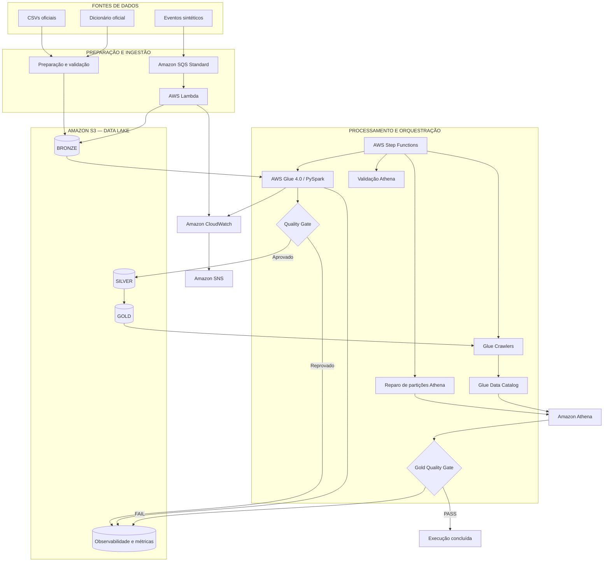

# Pipeline Híbrida de Alfabetização no Brasil — Tech Challenge Fase 2
**Projeto:** Pipeline Híbrida de Alfabetização no Brasil

**Curso:** POSTECH / FIAP — AI Scientist

**Repositório:** [Tech-Challenge-Pipeline-Fase-2](https://github.com/Eric-Schwinn-Lima/Tech-Challenge-Pipeline-Fase-2)

**Região AWS:** `us-east-2` — Ohio

**Arquitetura:** Amazon S3, AWS Glue 4.0 / PySpark, Step Functions, SQS, Lambda, Glue Data Catalog, Athena, CloudWatch e Terraform.

**Autor:** Eric Schwinn Lima

**Vídeo executivo:** (https://youtu.be/9-dUN78Z7yM)  
**Apresentação:** (\docs\apresentacao)

---
## 1. Resumo
O projeto implementa uma pipeline híbrida de dados para integrar informações públicas relacionadas à alfabetização no Brasil, preservar os dados de origem, padronizar tabelas, executar verificações de qualidade e disponibilizar produtos analíticos para consulta.

A solução utiliza arquitetura Medallion, dividida em três camadas:

- **Bronze:** preservação dos dados brutos e histórico de ingestão.

- **Silver:** dados padronizados, normalizados e validados.

- **Gold:** fatos, indicadores e produtos analíticos para consulta.

O processamento batch é realizado pelo AWS Glue 4.0 com PySpark. A infraestrutura é provisionada pelo Terraform. A orquestração completa é realizada pelo AWS Step Functions, que executa o Glue, acompanha os crawlers Silver e Gold, repara partições e valida os resultados por meio do Athena.

A integração de eventos utiliza Amazon SQS Standard, AWS Lambda e S3. Os eventos de demonstração são sintéticos e não representam atualização oficial do indicador em tempo real.

**Resultado final da validação AWS em 02/11/2026:**
| Indicador | Resultado |
|---|---:|
| Step Functions | `SUCCEEDED` |
| Glue Job | `SUCCEEDED` |
| Quality Gate | `PASS` |
| Tabelas Gold verificadas | 8 |
| Linhas somadas nas oito tabelas Gold | 187.200 |
| Evento sintético validado na Gold | 1 |
| Erros da execução final | 0 |

A execução final foi concluída em aproximadamente 11 minutos e 10 segundos. O total de 187.200 corresponde à soma das linhas contabilizadas nas oito tabelas Gold naquela validação; não representa pessoas, alunos ou municípios únicos.

Em 03/11/2026, após o ajuste dos Crawlers e a limpeza seletiva dos metadados redundantes, o Glue Data Catalog passou a apresentar **16 tabelas principais: oito Silver e oito Gold**, sem entradas extras `run_id_*`. Os objetos de dados no S3 foram preservados.

## 2. Objetivo e escopo funcional
A pipeline integra os resultados publicados de alfabetização por Brasil, UF e município, metas nacionais, estaduais e municipais, microdados de alunos e um dicionário de códigos.

O projeto permite:


- Consultar resultados por município e unidade federativa.

- Comparar resultados com metas disponíveis.

- Analisar a evolução temporal dos indicadores.

- Investigar diferenças entre resultados agregados publicados e cálculos exploratórios derivados dos microdados.

- Rastrear dados e resultados por execução.

- Demonstrar uma integração técnica de eventos por SQS, Lambda e S3.

A referência utilizada para classificar a criança alfabetizada é o corte de **743 pontos na escala de proficiência do Saeb**, conforme a Pesquisa Alfabetiza Brasil.

O indicador agregado publicado e a taxa calculada a partir dos microdados são produtos diferentes e devem ser interpretados separadamente.

### 2.1 Potencial de aplicação em inteligência artificial

As tabelas Gold podem servir como base para estudos futuros de previsão de risco de não atingimento de metas, identificação de desigualdades regionais e análise de padrões de evolução dos indicadores. A versão atual **não treina nem publica um modelo de Machine Learning**. Para uma etapa futura, será necessário definir o horizonte de previsão, selecionar variáveis disponíveis antes do período previsto e evitar vazamento de alvo.

**Fonte principal:** [Base dos Dados — Avaliação da Alfabetização](https://basedosdados.org/dataset/073a39d4-89cf-4068-b1e8-34ed0d9c0b72), dataset `br_inep_avaliacao_alfabetizacao`.

## 3. Arquitetura da solução
A arquitetura combina processamento batch, integração demonstrativa de eventos e orquestração automatizada.



### 3.1 Componentes AWS
| Serviço | Responsabilidade |
|---|---|
| Amazon S3 | Data Lake e armazenamento das camadas Bronze, Silver e Gold, eventos e resultados de execução. |
| Amazon SQS Standard | Fila de eventos sintéticos para demonstração. |
| AWS Lambda | Consome mensagens SQS, valida eventos e grava registros JSONL na Bronze. |
| AWS Glue 4.0 / PySpark | Executa transformações, verificações de qualidade e publicação Silver/Gold. |
| AWS Step Functions | Orquestra o processamento Glue, crawlers, reparos de partições e validação final. |
| AWS Glue Crawlers | Descobrem esquemas e partições nos prefixos Silver e Gold. |
| AWS Glue Data Catalog | Mantém os metadados das tabelas analíticas. |
| Amazon Athena | Executa consultas SQL e valida os resultados Gold. |
| Amazon CloudWatch | Logs, métricas operacionais e alarmes. |
| Amazon SNS | Distribui notificações de monitoramento. |
| Terraform | Provisionamento e atualização da infraestrutura como código. |

**Decisão de mensageria:** foi utilizado SQS Standard em vez de Kinesis Data Streams porque uma restrição organizacional (SCP) da conta AWS negava a operação necessária para Kinesis. O fluxo SQS → Lambda → S3 foi validado com eventos sintéticos. O acionamento automático da Lambda permanece desabilitado fora dos períodos de teste/demonstração, para evitar polling ocioso da fila; portanto, não descreva a solução como um serviço contínuo de atualização oficial em tempo real.

## 4. Organização das camadas Medallion
### 4.1 Bronze — preservação dos dados
A camada Bronze preserva os dados recebidos e a rastreabilidade da ingestão.

Principais grupos de dados:

- Arquivos brutos exportados da fonte.

- CSVs canônicos utilizados pelo processamento.

- Dicionário oficial.

- Eventos JSONL recebidos via Lambda.

- Metadados de execução e informações de observabilidade.

Prefixos principais:

```text

bronze/

├── raw_exports/

├── source/

└── streaming/

```

### 4.2 Silver — padronização e qualidade
A camada Silver contém os dados tratados pelo Glue:

- Chaves municipais normalizadas.

- Tipos numéricos e categorias padronizados.

- Códigos originais preservados.

- Descrições categóricas acrescentadas quando compatíveis com o dicionário.

- Valores nulos relevantes preservados.

- Indicadores calculados a partir dos microdados.

- Eventos inválidos separados para quarentena.

Tabelas Silver:

1. `alunos`

2. `dicionario`

3. `indicador_calculado_microdados`

4. `meta_alfabetizacao_brasil`

5. `meta_alfabetizacao_municipio`

6. `meta_alfabetizacao_uf`

7. `municipio`

8. `uf`

### 4.3 Gold — produtos analíticos
A camada Gold contém oito produtos verificados pela execução final:
| Tabela | Finalidade |
|---|---|
| `fato_alfabetizacao_municipio` | Resultados municipais e comparação com metas disponíveis. |
| `mart_alfabetizacao_uf` | Indicadores e comparações por unidade federativa. |
| `mart_evolucao_temporal` | Evolução anual dos indicadores. |
| `mart_acompanhamento_metas` | Acompanhamento de resultados em relação às metas. |
| `mart_streaming_eventos` | Eventos sintéticos processados para análise. |
| `reconciliacao_microdados` | Comparação exploratória entre os microdados e o indicador publicado. |
| `mart_trajetoria_metas` | Trajetória dos resultados e das metas. |
| `mart_perfil_proficiencia` | Perfil dos registros por categorias de proficiência. |

As saídas Silver e Gold são armazenadas em Parquet com compressão Snappy e particionadas por `run_id`.

Exemplo conceitual:

```text

silver/

  tabela/

    run_id=\<identificador>/

gold/

  tabela/

    run_id=\<identificador>/

```

O filtro por `run_id` é necessário para consultar somente os registros da execução desejada.

**Catálogo atualizado em 03/11/2026:** 16 tabelas principais (oito Silver e oito Gold). A configuração dos Crawlers usa `Grouping.TableLevelConfiguration = 2`, tratando `run_id=...` como partição, não como tabela. Foram removidas 24 definições antigas `run_id_*` exclusivamente do Glue Data Catalog; nenhum objeto Parquet no S3 foi excluído.

## 5. Orquestração automatizada
A máquina de estados utilizada é:

`tc-alfabetizacao-a9455abd-pipeline-orchestrator`

A orquestração foi ampliada para executar o fluxo completo, não apenas o job Glue.

### 5.1 Fluxo de execução
1. **GenerateRunId:** gera um identificador único para a execução.

2. **RunMedallionGlueJob:** inicia o Glue e transmite o identificador por `--RUN_ID`.

3. **StartSilverCrawler:** inicia o crawler Silver.

4. **WaitSilverCrawler / GetSilverCrawler:** acompanha a execução até a conclusão.

5. **StartGoldCrawler:** inicia o crawler Gold.

6. **WaitGoldCrawler / GetGoldCrawler:** acompanha a execução até a conclusão.

7. **RepairFactMunicipalPartitions:** executa `MSCK REPAIR TABLE fato_alfabetizacao_municipio`.

8. **RepairUfMartPartitions:** executa `MSCK REPAIR TABLE mart_alfabetizacao_uf`.

9. **ValidateGoldAthena:** executa a consulta de qualidade sobre as oito tabelas Gold.

10. **GetGoldValidationResults:** lê o resultado da consulta Athena.

11. **GoldQualityGate:** verifica se o resultado é `PASS`.

12. **PipelineSucceeded / PipelineFailed:** encerra a execução conforme o resultado.

Os estados de espera consultam o Glue Data Catalog até que os crawlers estejam prontos e o último processamento esteja concluído.

### 5.2 Propagação do identificador
O identificador é gerado pela Step Functions e transmitido ao Glue.

Exemplo da execução final:

```text

run_id:

d5095134-779d-453d-b55a-c67a020ca4f3

```

O argumento recebido pelo Glue foi:

```text

--RUN_ID=d5095134-779d-453d-b55a-c67a020ca4f3

```

O uso do mesmo identificador permite rastrear os dados produzidos, os resultados analíticos e as métricas da execução.

### 5.3 Quality Gate final no Athena
A consulta valida a existência das oito tabelas e exige registros positivos nas sete tabelas batch obrigatórias. A tabela de streaming é obrigatória para a verificação estrutural, mas pode conter zero ou mais registros.

A execução final retornou:

```text

quality_status = PASS

tables_checked = 8

total_rows = 187200

streaming_rows = 1

```

O caminho correto para recuperar o identificador da consulta na resposta da integração Athena é:

```text

$.gold_validation.QueryExecution.QueryExecutionId

```

Esse caminho foi corrigido após o primeiro teste de ponta a ponta identificar um erro de referência JSONPath. A definição corrigida foi validada pela API da AWS e aplicada pelo Terraform.

## 6. Evidência da execução final na AWS
### 6.1 Identificação
| Campo | Resultado |
|---|---|
| Data | 02/11/2026 |
| Região | `us-east-2` |
| Run ID | `d5095134-779d-453d-b55a-c67a020ca4f3` |
| Glue Job | `tc-alfabetizacao-a9455abd-medallion-pipeline` |
| Glue Job Run ID | `jr_72e1d75c775ccf77fc2675b98ffc00f12b5c3652f41068de5119dbe88e444fd7` |
| Step Functions | `SUCCEEDED` |
| Início | 17:03:53 (horário de Brasília) |
| Encerramento | 17:15:03 (horário de Brasília) |
| Duração total | Aproximadamente 11 min 10 s |

### 6.2 Glue
| Indicador | Resultado |
|---|---:|
| Status | `SUCCEEDED` |
| Glue Version | 4.0 |
| Worker Type | G.1X |
| Workers | 2 |
| Tempo de execução | 371 segundos |
| DPUSeconds | 742 |
| Erro | Nenhum |

### 6.3 Crawlers e partições
| Etapa | Resultado |
|---|---|
| Crawler Silver | `SUCCEEDED` |
| Crawler Gold | `SUCCEEDED` |
| Reparo da fato municipal | `SUCCEEDED` |
| Reparo da mart por UF | `SUCCEEDED` |

### 6.4 Resultado Athena
| Métrica | Resultado |
|---|---:|
| Qualidade | `PASS` |
| Tabelas verificadas | 8 |
| Registros contabilizados | 187.200 |
| Registros streaming | 1 |

Identificador da consulta final:

`94a4e66c-83d8-459a-baef-41777bfd36ce`

A consulta terminou com `SUCCEEDED`, e seus resultados foram lidos corretamente pela Step Functions.

### 6.5 Estado do catálogo em 03/11/2026

Após a aplicação do ajuste de profundidade dos Crawlers, Silver e Gold foram rastreadas novamente com status `SUCCEEDED`. O catálogo passou a conter 16 tabelas principais e nenhuma entrada redundante `run_id_*`. A limpeza removeu somente 24 definições de metadados antigos do Glue Data Catalog; os arquivos Parquet e demais objetos no S3 foram preservados.

### 6.6 Evidência de correção
O primeiro teste completo processou os dados corretamente e obteve `PASS` no Athena, mas terminou como `FAILED` porque a etapa `GetGoldValidationResults` utilizava um JSONPath incorreto.

A correção foi aplicada na definição da máquina de estados. O novo plano Terraform apresentou somente uma atualização in-place da Step Functions, sem criação, destruição ou alteração da Lambda.

Na execução seguinte, o resultado Athena foi recuperado corretamente e a máquina de estados terminou como `SUCCEEDED`.

## 7. Qualidade de dados e limitações
O Quality Gate é executado antes da publicação das camadas analíticas. Entre as regras implementadas estão:

- Presença de tabelas e colunas obrigatórias.

- Verificação de chaves nulas.

- Duplicidade de chaves naturais.

- Percentuais e metas no intervalo permitido.

- Validade de presença, alfabetização e peso amostral.

- Taxas mínimas de correspondência entre tabelas.

- Validação e deduplicação de eventos.

Foram documentados testes positivos e negativos. Nas execuções negativas com duplicidade da chave natural municipal, o Glue terminou em `FAILED` e impediu a publicação das saídas Silver e Gold daquela execução.

### Limitações que devem acompanhar a interpretação dos resultados
**Microdados:** a execução histórica leu 1.048.575 registros de alunos. Esse número coincide com o limite de linhas de dados de uma planilha Excel, considerando uma linha adicional de cabeçalho. É um alerta de possível truncamento, mas não prova perda de registros. A completude deve ser confirmada com a fonte original.

**Cobertura de metas:** metas municipais não estão disponíveis ou não possuem correspondência para todos os recortes. Na validação histórica da fato municipal, 18.763 registros não possuíam uma meta municipal preenchida. Ausência de meta não significa meta não atingida.

**Cobertura temporal:** a tabela municipal de metas disponível inicia em 2024; portanto, registros de 2023 não podem ser comparados com uma meta municipal dessa tabela. Também foram identificadas lacunas de correspondência em 2024 e valores de meta vazios na própria fonte.

**Streaming:** o registro de streaming da execução final é demonstrativo e sintético. Não representa atualização oficial em tempo real do indicador de alfabetização.

**Indicador temporal:** a média simples municipal é uma métrica descritiva não ponderada. Não substitui o indicador oficial nacional.

**Modelos preditivos:** a versão atual não treina nem publica um modelo de Machine Learning. As tabelas Gold podem servir de base para estudos futuros, desde que sejam definidos o horizonte de previsão e os controles contra vazamento de informação.

## 8. Infraestrutura como código e atualização Terraform
A infraestrutura é declarada em `cloud/terraform/`.

Na atualização de 02/11/2026, foram aplicadas duas revisões Terraform:

**Primeira aplicação:**
| Recurso | Alteração |
|---|---|
| `aws_iam_role_policy.step_functions` | Inclusão das permissões necessárias à nova orquestração. |
| `aws_s3_object.glue_script` | Publicação do script Glue com suporte ao `--RUN_ID`. |
| `aws_sfn_state_machine.pipeline` | Integração dos crawlers, reparos e validação Athena. |

Resultado: `0 added, 3 changed, 0 destroyed`.

**Segunda aplicação:**
| Recurso | Alteração |
|---|---|
| `aws_sfn_state_machine.pipeline` | Correção do JSONPath da resposta Athena. |

Resultado: `0 added, 1 changed, 0 destroyed`.

A Lambda de streaming não foi atualizada nessas aplicações. A divergência de hash do pacote local foi investigada e identificada como diferença de terminações de linha (`CRLF` no Windows e `LF` no pacote da AWS). A normalização permitiu gerar um plano sem atualização da Lambda.

Validações realizadas:

- `terraform fmt -recursive`

- `terraform validate`

- `aws stepfunctions validate-state-machine-definition` sobre a definição renderizada pelo plano Terraform.

A validação final da definição retornou `OK`, sem diagnósticos.

**Segurança operacional:** o diretório original de gerenciamento contém o estado Terraform. O clone do GitHub não deve ser tratado como substituto desse estado. Não executar `terraform apply` a partir de um clone sem estado nem remover ou publicar o `terraform.tfstate`.

## 9. Observabilidade e FinOps
### 9.1 Monitoramento
A arquitetura utiliza CloudWatch para logs, métricas e alarme de erro da Lambda, com notificações pelo SNS.

Métricas customizadas documentadas:

- `EventsIngested`

- `InvalidEvents`

- `EventLatencySeconds`

Namespace:

`AlfabetizacaoPipeline`

O alarme da Lambda foi configurado com limiar de um erro e ações de notificação associadas ao SNS.

### 9.2 Controle do streaming
A análise FinOps identificou 20.779 recebimentos vazios de SQS em 29/10/2026 para apenas duas mensagens enviadas, recebidas e excluídas.

Como a integração streaming é utilizada para testes e demonstrações, o Event Source Mapping foi definido para permanecer desabilitado por padrão fora dos períodos de teste.

A fila SQS e a Lambda permanecem provisionadas. A habilitação deve ser temporária, seguida da confirmação do retorno ao estado `Disabled`.

### 9.3 Medições financeiras
A fotografia de custos de 1º a 29/10/2026 identificou:
| Item | Medição histórica |
|---|---:|
| Armazenamento S3 versionado | 0,2564 GiB |
| Glue — cinco execuções | 1.987 DPU-segundos |
| Glue — cinco execuções | 0,551944 DPU-hora |
| Athena — 13 consultas anteriores | 1.886.683 bytes verificados |
| Recebimentos vazios SQS em 29/10 | 20.779 |

As duas novas execuções Glue de 02/11/2026 reportaram:
| Execução | DPUSeconds |
|---|---:|
| Primeiro teste completo (Glue concluído; orquestração falhou no JSONPath) | 642 |
| Execução final ponta a ponta | 742 |
| **Total adicional em 02/11** | **1.384** |

Somando as cinco execuções registradas na fotografia anterior às duas execuções de validação de novembro, temos **3.371 DPU-segundos**, equivalentes a aproximadamente **0,9364 DPU-hora**.

Usando apenas a taxa histórica de referência de US$ 0,44 por DPU-hora, isso corresponde a aproximadamente **US$ 0,412 de referência para as sete execuções Glue**. Não é valor de fatura e não inclui o custo dos crawlers nem os demais serviços.

A consulta do Cost Explorer de outubro retornou `UnblendedCost = 0` nas linhas exibidas, mas os dados estavam marcados como estimados e agregados à conta/região. Portanto, não é correto afirmar que o custo total da arquitetura é zero.

O AWS Budget documentado foi configurado com limite diário de US$ 10,00 e alerta em 85%, equivalente a US$ 8,50. O orçamento serve para monitoramento e notificação; não bloqueia automaticamente a utilização dos recursos.

**Limitação da estimativa:** a fotografia de armazenamento S3 e a amostra de consultas Athena são históricas. O valor de US$ 0,412 considera apenas as sete execuções Glue contabilizadas e uma taxa de referência; não inclui crawlers nem os demais serviços. A extração do Cost Explorer estava marcada como estimada e agregada à conta/região, sem atribuição financeira completa ao projeto. Portanto, não há um custo mensal total definitivo da solução nesta documentação.

## 10. Consultas de auditoria no Athena
A consulta abaixo permite verificar a quantidade de registros de cada tabela Gold para a execução final.

```sql

SELECT 'fato_alfabetizacao_municipio' AS table_name, COUNT(*) AS row_count

FROM fato_alfabetizacao_municipio

WHERE run_id = 'd5095134-779d-453d-b55a-c67a020ca4f3'

UNION ALL

SELECT 'mart_alfabetizacao_uf', COUNT(*)

FROM mart_alfabetizacao_uf

WHERE run_id = 'd5095134-779d-453d-b55a-c67a020ca4f3'

UNION ALL

SELECT 'mart_evolucao_temporal', COUNT(*)

FROM mart_evolucao_temporal

WHERE run_id = 'd5095134-779d-453d-b55a-c67a020ca4f3'

UNION ALL

SELECT 'mart_acompanhamento_metas', COUNT(*)

FROM mart_acompanhamento_metas

WHERE run_id = 'd5095134-779d-453d-b55a-c67a020ca4f3'

UNION ALL

SELECT 'mart_streaming_eventos', COUNT(*)

FROM mart_streaming_eventos

WHERE run_id = 'd5095134-779d-453d-b55a-c67a020ca4f3'

UNION ALL

SELECT 'reconciliacao_microdados', COUNT(*)

FROM reconciliacao_microdados

WHERE run_id = 'd5095134-779d-453d-b55a-c67a020ca4f3'

UNION ALL

SELECT 'mart_trajetoria_metas', COUNT(*)

FROM mart_trajetoria_metas

WHERE run_id = 'd5095134-779d-453d-b55a-c67a020ca4f3'

UNION ALL

SELECT 'mart_perfil_proficiencia', COUNT(*)

FROM mart_perfil_proficiencia

WHERE run_id = 'd5095134-779d-453d-b55a-c67a020ca4f3'

ORDER BY table_name;

```

Essa consulta complementa a validação agregada, permitindo registrar a contagem individual de cada produto Gold na evidência da entrega.

## 11. Estrutura do repositório
```text

Tech-Challenge-Pipeline-Fase-2/

├── cloud/

│   ├── lambda/

│   │   └── stream_to_s3.py

│   └── terraform/

│       ├── main.tf

│       ├── state_machine.asl.json.tftpl

│       └── variables.tf

├── config/

├── data/

│   ├── events/

│   ├── exports_raw/

│   ├── source/

│   └── observability/

├── docs/
│   ├── apresentacao/                 # PowerPoint e PDF da apresentação executiva
│   ├── evidencias/
│   │   └── aws/                       # Evidências visuais da infraestrutura

│   ├── architecture.md

│   ├── deploy_aws.md

│   ├── dicionario_dados.md

│   ├── evidencias_execucao.md

│   ├── finops.md

│   └── runbook.md

├── jobs/

│   └── glue_medallion_job.py

├── scripts/

│   └── run_aws_pipeline.py

├── src/

│   └── alfabetiza_pipeline/

├── tests/

├── README.md

├── pyproject.toml

└── Makefile

```

Dados completos de origem, arquivos locais de execução e artefatos sensíveis de infraestrutura não devem ser publicados no Git.

## 12. Vídeo e apresentação executiva

O vídeo executivo foi publicado no YouTube e apresenta o problema, o fluxo da solução, a ingestão batch e por eventos, a organização das camadas, as evidências de execução, as limitações conhecidas e o potencial de uso analítico/IA.

- **Vídeo:** [Assistir no YouTube](https://youtu.be/9-dUN78Z7yM)
- **Apresentação:** [Pasta docs/apresentacao](docs/apresentacao/)
- **Evidências AWS:** [Pasta docs/evidencias/aws](docs/evidencias/aws/)

Os eventos de streaming mostrados são sintéticos e não devem ser apresentados como atualizações oficiais do indicador. 

## 13. Checklist de encerramento da entrega

### Implementação e validação concluídas

- [x] Pipeline batch implantada e executada na AWS.
- [x] Arquivos de origem preservados na Bronze (`raw_exports/` e `source/`).
- [x] Camadas Bronze, Silver e Gold processadas.
- [x] Glue Job concluído com `SUCCEEDED`.
- [x] Crawlers Silver e Gold concluídos com `SUCCEEDED`.
- [x] Reparo de partições e Quality Gate Athena executados na orquestração.
- [x] Oito tabelas Gold verificadas com resultado `PASS`.
- [x] Step Functions finalizada com `SUCCEEDED` na execução integrada de 02/11/2026.
- [x] Catálogo corrigido em 03/11/2026 para 16 tabelas principais (oito Silver e oito Gold).
- [x] Ingestão de eventos sintéticos testada até a tabela analítica.
- [x] Monitoramento, retenção de logs e medições FinOps documentados.
- [x] Vídeo executivo publicado no YouTube.
- [x] Apresentação executiva adicionada à pasta `docs/apresentacao/`.


## 14. Conclusão
A solução demonstra uma pipeline híbrida de dados para análise da alfabetização, com processamento batch, ingestão demonstrativa de eventos, arquitetura Medallion, catálogo analítico, consultas, verificações de qualidade, observabilidade e infraestrutura como código.

A principal evolução da última etapa foi a integração de todo o ciclo operacional na Step Functions: processamento Glue, atualização dos crawlers, reparo de partições, validação Athena e Quality Gate final.

A execução de 02/11/2026 confirmou o funcionamento ponta a ponta, com oito tabelas verificadas, 187.200 linhas somadas na validação e resultado `PASS`, encerrando a máquina de estados com `SUCCEEDED`. Em 03/11/2026, o catálogo foi corrigido e validado com 16 tabelas principais.

As limitações das fontes, a natureza sintética dos eventos e as ressalvas da análise financeira permanecem documentadas para garantir uma apresentação tecnicamente transparente e reproduzível.
