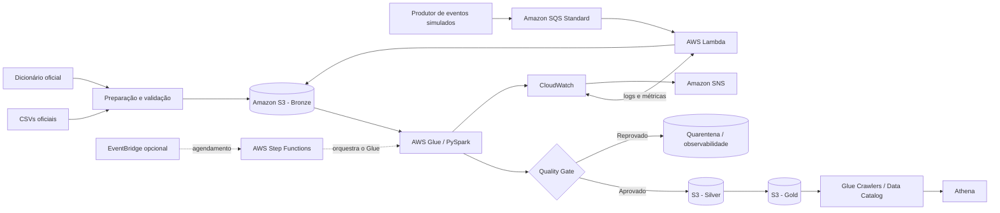

# Pipeline Híbrida de Alfabetização no Brasil — Tech Challenge Fase 2

**Projeto acadêmico de Engenharia de Dados | POSTECH / FIAP — AI Scientist**

[](https://www.python.org/)
[](https://aws.amazon.com/)
[](https://www.terraform.io/)
[](#testes)

> **Status da entrega:** pipeline executada localmente e implantada/validada na AWS. A execução AWS documentada processou as camadas Bronze, Silver e Gold, catalogou 12 tabelas e concluiu o job Glue com `SUCCESS` e o relatório de qualidade com `PASSED`. As limitações de cobertura das metas e de completude dos microdados permanecem explicitadas neste documento.

## 1. Visão geral

Este projeto implementa uma pipeline de dados híbrida — processamento batch e ingestão de eventos — para integrar dados públicos associados ao Indicador Criança Alfabetizada. A solução preserva os arquivos recebidos, padroniza as tabelas, aplica verificações de qualidade e disponibiliza produtos analíticos para acompanhar resultados de alfabetização e sua comparação com metas.

A referência técnica adotada para classificar a criança alfabetizada é o corte de **743 pontos na escala de proficiência do Saeb**, conforme a Pesquisa Alfabetiza Brasil. A meta pactuada para a rede pública na trajetória até 2030 deve ser analisada separadamente da aspiração de universalização da alfabetização.

O projeto permite investigar questões como:

- Qual é o resultado publicado por município e por UF, considerando ano, série e rede?
- Qual é a distância entre o resultado observado e as metas disponíveis?
- Como o indicador evolui ao longo dos anos?
- Qual é a diferença entre o indicador agregado publicado e a taxa calculada a partir dos microdados?
- Quais eventos chegaram pelo fluxo SQS/Lambda e quais são apenas eventos simulados?

**Importante:** os eventos de streaming usados nos testes são sintéticos. Eles demonstram a integração técnica, mas não representam atualização oficial do indicador em tempo real.

## 2. Fonte de dados

A fonte principal é a [Base dos Dados — Avaliação da Alfabetização](https://basedosdados.org/dataset/073a39d4-89cf-4068-b1e8-34ed0d9c0b72), dataset `br_inep_avaliacao_alfabetizacao`, derivado de resultados do Inep.

A solução utiliza arquivos CSV exportados da fonte e enviados para a AWS. Essa abordagem evita exigir um projeto de billing do Google Cloud para consultas BigQuery e mantém o processamento operacional concentrado na AWS.

### Tabelas utilizadas

| Arquivo/tabela | Uso na pipeline |
|---|---|
| `uf` | Resultados publicados por UF, ano, série e rede. |
| `municipio` | Resultados publicados por município, ano, série e rede. |
| `meta_alfabetizacao_brasil` | Metas nacionais para comparação temporal. |
| `meta_alfabetizacao_uf` | Metas estaduais por ano e recorte. |
| `meta_alfabetizacao_municipio` | Metas municipais por ano e recorte. |
| `alunos` | Microdados usados no cálculo exploratório da taxa ponderada de alfabetização. |
| `dicionario` | Tabela auxiliar oficial para interpretação dos códigos categóricos. |

O dicionário oficial é fornecido separadamente das seis tabelas de dados. Ele é utilizado para interpretar códigos de `rede`, `serie`, `presenca` e `alfabetizado` quando as categorias são compatíveis, mantendo os códigos originais nas tabelas.

### Disponibilidade dos arquivos

O repositório **não distribui o ZIP completo dos microdados nem os CSVs completos de alunos**. Esses arquivos não são versionados para evitar publicar grandes volumes de dados de origem. O arquivo auxiliar `data/exports_raw/dicionario.csv` e o inventário `data/exports_raw/source_inventory.json` estão versionados.

Para executar a pipeline com os dados completos:

1. Acesse a [Base dos Dados — Avaliação da Alfabetização](https://basedosdados.org/dataset/073a39d4-89cf-4068-b1e8-34ed0d9c0b72).
2. Baixe o pacote ZIP com as seis tabelas de dados.
3. Salve o arquivo com o nome `dados_oficiais_base_dados.zip` em `data/exports_raw/`.
4. Mantenha `dicionario.csv` nessa mesma pasta. O arquivo já está presente no repositório; caso obtenha uma versão atualizada, confira sua origem e estrutura antes de substituí-lo.
5. Execute `python scripts/prepare_real_data.py` para extrair e preparar as fontes.

Os CSVs preparados em `data/source/` e os arquivos brutos extraídos em `data/exports_raw/` são locais e estão ignorados pelo Git. Os arquivos pequenos em `tests/fixtures/` são amostras sintéticas/de teste e não substituem as fontes oficiais completas.

### Preparação e decisões de padronização

O adaptador de preparação realiza as seguintes conversões, preservando os arquivos de origem:

- Deriva `sigla_uf` a partir do prefixo do código IBGE, pois os arquivos de alunos e o agregado municipal não trazem essa coluna em sua forma original.
- Converte as colunas de metas de 2024 a 2030 do formato largo para linhas por ano-alvo, mantendo o ano do snapshot para rastreabilidade.
- Define `serie = 2`, conforme o recorte do indicador tratado no enunciado do projeto.
- Resolve categorias de rede das tabelas de metas a partir do dicionário oficial.
- Mantém os arquivos originais separados das tabelas canônicas usadas pela pipeline.

**Equivalência semântica de rede:** a fonte apresenta a categoria `Pública (Estadual e Municipal)` no dicionário, enquanto a tabela de metas utiliza o rótulo resumido `Pública`. O adaptador associa o rótulo resumido ao código 5 do dicionário. Essa equivalência deve ser considerada na interpretação dos resultados; ela não é uma correspondência literal do texto da fonte.

O inventário produzido pela preparação fica em `data/exports_raw/source_inventory.json`.

## 3. Arquitetura da solução

A solução utiliza arquitetura medalhão na AWS, com ingestão batch e entrada de eventos simulados por fila.



### Componentes AWS

| Componente | Responsabilidade |
|---|---|
| Amazon S3 | Data Lake com prefixos Bronze, Silver, Gold, streaming e observabilidade. |
| Amazon SQS Standard | Fila de eventos de demonstração. |
| AWS Lambda | Consome mensagens SQS, valida o timestamp, registra dados de ingestão e grava eventos JSONL na Bronze do S3. |
| AWS Glue 4.0 / PySpark | Processa os CSVs canônicos, executa verificações e publica Silver/Gold em Parquet Snappy. |
| AWS Step Functions | Orquestra a execução do job Glue. |
| AWS Glue Data Catalog | Catálogo das tabelas Silver e Gold. |
| Glue Crawlers | Descobrem esquemas e partições nos prefixos do S3. |
| Amazon Athena | Consulta os dados catalogados usando SQL. |
| Amazon CloudWatch | Logs, métricas e alarme de erro da Lambda. |
| Amazon SNS | Notificações associadas ao monitoramento. |
| Terraform | Provisionamento repetível da infraestrutura. |

**Decisão de mensageria:** a implementação atual utiliza **SQS Standard**, não Kinesis Data Streams. A troca foi necessária porque a política organizacional da conta AWS não permitia criar recursos Kinesis. A arquitetura e os exemplos deste README refletem a implementação SQS efetivamente publicada.

### Princípios de execução e idempotência

- Cada execução recebe um `run_id` e grava resultados em caminhos versionados.
- Os arquivos Bronze preservam o histórico dos dados recebidos.
- Silver e Gold são gravadas por execução, sem sobrescrever diretamente resultados anteriores.
- Eventos são identificados por `event_id` para permitir deduplicação no processamento analítico.
- A mensageria SQS Standard deve ser considerada de entrega pelo menos uma vez; consumidores precisam tolerar mensagens repetidas.
- Uma falha no quality gate impede a publicação das camadas seguintes e gera relatório de qualidade.
- O versionamento S3 preserva versões anteriores; o ciclo de vida configurado expira versões não correntes após 90 dias.

## 4. Camadas do Data Lake — Medallion

### Bronze — dados brutos e histórico

A Bronze preserva os dados de entrada e a rastreabilidade da ingestão:

- CSVs originais exportados da fonte, no prefixo `bronze/raw_exports/`.
- CSVs canônicos utilizados pelo Glue, no prefixo `bronze/source/`.
- Dicionário oficial usado para interpretar os códigos.
- Eventos JSONL recebidos pelo consumidor Lambda, em `bronze/streaming/`.
- Metadados de execução, como `run_id`, datas, quantidade de registros e informações de integridade quando aplicável.

### Silver — dados padronizados

A Silver contém tabelas normalizadas e prontas para análise:

- Chaves municipais normalizadas para string de sete dígitos.
- Tipos numéricos, percentuais e categorias padronizados.
- Códigos originais preservados e descrições categóricas acrescentadas quando compatíveis com o dicionário.
- Valores nulos relevantes preservados; ausência de dado não é convertida em zero.
- Indicador calculado a partir dos microdados, considerando alunos presentes e pesos amostrais válidos.
- Eventos inválidos separados para quarentena; duplicatas podem ser removidas pela chave de evento no fluxo analítico.

Na execução AWS registrada, o Glue Catalog apresentou as seguintes tabelas Silver:

- `alunos`
- `dicionario`
- `indicador_calculado_microdados`
- `meta_alfabetizacao_brasil`
- `meta_alfabetizacao_municipio`
- `meta_alfabetizacao_uf`
- `municipio`
- `uf`

### Gold — produtos analíticos

| Tabela | Conteúdo |
|---|---|
| `fato_alfabetizacao_municipio` | Resultado municipal publicado, metas disponíveis, distância em pontos percentuais e classificação do recorte. |
| `mart_alfabetizacao_uf` | Resultado por UF e comparação com metas estadual/nacional. |
| `mart_evolucao_temporal` | Evolução anual. A média simples municipal é descritiva, não oficial e não ponderada. |
| `reconciliacao_microdados` | Comparação exploratória entre taxa ponderada calculada dos microdados e taxa agregada publicada. |
| `mart_streaming_eventos` | Tabela prevista no desenho analítico para eventos simulados válidos; **não foi produzida na execução AWS documentada**, pois os eventos de teste não continham todos os campos analíticos exigidos. |

Os status de comparação com metas devem ser interpretados com cuidado:

- `ATINGIDA`: resultado atingiu ou superou a meta aplicável.
- `ABAIXO_DA_META`: resultado ficou abaixo da meta aplicável.
- `SEM_META`: não há valor de meta disponível para aquela combinação.
- `SEM_RESULTADO`: não há resultado para o recorte.
- `NAO_COMPARAVEL`: a categoria de rede não corresponde ao recorte definido pela meta.

A ausência de uma meta **não significa descumprimento**. A meta pactuada pela fonte e a aspiração de universalização da alfabetização são conceitos diferentes e não devem ser misturados.

### Particionamento e formatos

As saídas AWS Silver/Gold são gravadas em Parquet com compressão Snappy e particionadas por execução (`run_id`). Ao consultar no Athena, filtre o `run_id` desejado para não combinar registros de execuções diferentes.

## 5. Qualidade de dados e observabilidade

O quality gate controla a publicação das camadas seguintes. O limite mínimo de correspondência de joins é configurável por `min_join_match_rate` no Terraform, com padrão de 95%. A taxa máxima de pesos amostrais ausentes ou não positivos entre alunos elegíveis é configurável por `max_invalid_weight_rate`, com padrão de 0,1%.

Entre as verificações implementadas estão:

- Presença das seis tabelas obrigatórias e das colunas necessárias.
- Verificação de chaves nulas e duplicidade de chaves naturais.
- Validação de percentuais e metas no intervalo de 0 a 100.
- Verificação de presença e situação de alfabetização para alunos considerados no cálculo.
- Validação dos pesos amostrais; registros inelegíveis não recebem peso zero para forçar sua inclusão.
- Taxas de correspondência nos joins `alunos → municipio`, `municipio → uf` e joins de metas.
- Separação de redes comparáveis e não comparáveis às metas.
- Validação de eventos, timestamps, duplicidade e quarentena.
- Persistência de relatórios de qualidade e métricas de execução.

Arquivos e destinos de observabilidade:

- Local: `data/observability/quality_<run_id>.json`, histórico de qualidade e métricas da execução.
- AWS: `s3://<bucket>/observability/quality/` e logs/métricas no CloudWatch.
- Streaming: namespace CloudWatch `AlfabetizacaoPipeline`, com métricas `EventsIngested`, `InvalidEvents` e `EventLatencySeconds`.

Para diagnóstico e recuperação, consulte [`docs/runbook.md`](docs/runbook.md).

## 6. Como executar localmente

### Pré-requisitos

- Python 3.11 a 3.13. A versão validada em clone limpo foi Python 3.13.14. Python 3.14 não foi validado com as dependências fixadas.
- Git.
- Acesso aos arquivos exportados da Base dos Dados.
- PowerShell no Windows ou terminal Bash no Linux/macOS.

O modo local não precisa de conta AWS.

### Windows / VS Code / PowerShell

Clone o repositório e entre na pasta:

```powershell
git clone https://github.com/Eric-Schwinn-Lima/Tech-Challenge-Pipeline-Fase-2.git
cd Tech-Challenge-Pipeline-Fase-2
```

Crie e ative o ambiente virtual:

```powershell
py -3.13 -m venv .venv
.\.venv\Scripts\Activate.ps1
python -m pip install --upgrade pip
python -m pip install -e ".[test]"
```

Se o PowerShell bloquear a ativação do ambiente virtual, execute apenas na sessão atual:

```powershell
Set-ExecutionPolicy -Scope Process -ExecutionPolicy Bypass
.\.venv\Scripts\Activate.ps1
```

Baixe o ZIP das seis tabelas oficiais e salve-o em `data/exports_raw/dados_oficiais_base_dados.zip`. Em seguida, execute:

```powershell
python scripts/prepare_real_data.py
python scripts/validate_sources.py
python -m pytest -q
python scripts/run_local.py
```

### Linux / macOS

```bash
git clone https://github.com/Eric-Schwinn-Lima/Tech-Challenge-Pipeline-Fase-2.git
cd Tech-Challenge-Pipeline-Fase-2
python3.13 -m venv .venv
source .venv/bin/activate
python -m pip install --upgrade pip
python -m pip install -e '.[test]'
```

Depois de obter e colocar o ZIP em `data/exports_raw/dados_oficiais_base_dados.zip`:

```bash
python scripts/prepare_real_data.py
python scripts/validate_sources.py
python -m pytest -q
python scripts/run_local.py
```

### Saídas locais

Após a execução, confira:

- `data/bronze/`
- `data/silver/`
- `data/gold/`
- `data/observability/run_summary_<run_id>.json`
- `data/observability/run_metrics.jsonl`
- `data/observability/quality_<run_id>.json`

Com as dependências do `pyproject.toml`, a saída local preferencial é Parquet Snappy. Se PyArrow não estiver disponível, a pipeline local utiliza um fallback explicitamente identificado como `.csv.gz`; esse fallback não deve ser confundido com arquivos Parquet.

## 7. Testes automatizados

Os testes usam fixtures pequenas e verificam transformações, regras de qualidade e execução ponta a ponta sem exigir os arquivos oficiais completos.

Com o ambiente virtual ativado:

```powershell
python -m pytest -q
```

**Resultado validado em clone limpo (Python 3.13.14):** `9 passed in 1.66s`. Os testes utilizam fixtures pequenas e não exigem os CSVs oficiais completos.

Também foram executadas verificações de compilação Python e validação do Terraform:

```powershell
python -m compileall -q src scripts jobs
terraform -chdir=cloud/terraform fmt -check -recursive
terraform -chdir=cloud/terraform validate
```

Resultado registrado: compilação sem erros e configuração Terraform válida.

## 8. Implantação na AWS

> **Atenção a custos:** a implantação cria recursos AWS que podem gerar cobrança. Configure o orçamento e o monitoramento antes de provisionar a infraestrutura. Mantenha o agendamento automático desligado até validar as execuções manuais.

A implantação utilizada neste projeto foi realizada na região **`us-east-2`**. A infraestrutura é gerenciada por Terraform no diretório `cloud/terraform`.

O passo a passo completo está em [`docs/deploy_aws.md`](docs/deploy_aws.md). A sequência resumida é:

### 8.1. Validar credenciais e região

Configure o acesso AWS por um mecanismo seguro, preferencialmente IAM Identity Center/SSO ou o mecanismo de autenticação já adotado no ambiente. Não coloque Access Keys diretamente em scripts nem versione credenciais.

No PowerShell, defina o perfil que será usado:

```powershell
$env:AWS_PROFILE = "SEU_PERFIL_AWS"
aws sts get-caller-identity --profile $env:AWS_PROFILE
```

Confirme que a conta e a região são as esperadas antes de provisionar.

### 8.2. Provisionar a infraestrutura

```powershell
terraform -chdir=cloud/terraform init
terraform -chdir=cloud/terraform fmt -recursive
terraform -chdir=cloud/terraform validate
terraform -chdir=cloud/terraform plan -out=tfplan
terraform -chdir=cloud/terraform apply tfplan
```

Revise cuidadosamente o plano antes do `apply`. O Terraform cria, entre outros recursos, bucket S3, fila SQS, Lambda, roles/policies IAM, job Glue, Step Functions, crawlers, Data Catalog, workgroup Athena, alarme CloudWatch e tópico SNS.

A variável `enable_daily_schedule` deve permanecer `false` até que a execução manual seja validada. Caso utilize notificação SNS por e-mail, configure o destino em um arquivo local `terraform.tfvars` não versionado e confirme a assinatura recebida.

### 8.3. Obter os nomes dos recursos

```powershell
$bucket = terraform -chdir=cloud/terraform output -raw s3_bucket_name
$queueUrl = terraform -chdir=cloud/terraform output -raw sqs_queue_url
$stateMachine = terraform -chdir=cloud/terraform output -raw state_machine_arn
$glueJob = terraform -chdir=cloud/terraform output -raw glue_job_name
```

### 8.4. Preparar e carregar as fontes

Prepare os CSVs canônicos localmente:

```powershell
python scripts/prepare_real_data.py
python scripts/validate_sources.py
```

Carregue as sete tabelas (seis fontes e o dicionário) para a Bronze:

```powershell
aws s3 sync data/source/ "s3://$bucket/bronze/source/" --exclude "*" --include "*.csv" --region us-east-2 --profile $env:AWS_PROFILE
aws s3 ls "s3://$bucket/bronze/source/" --recursive --region us-east-2 --profile $env:AWS_PROFILE
```

O job Glue espera os arquivos `uf.csv`, `municipio.csv`, `meta_alfabetizacao_brasil.csv`, `meta_alfabetizacao_uf.csv`, `meta_alfabetizacao_municipio.csv`, `alunos.csv` e `dicionario.csv` no prefixo `bronze/source/`.

### 8.5. Testar o fluxo SQS → Lambda → S3

Os eventos do repositório são simulados. Para enviar uma amostra à fila:

```powershell
python scripts/send_sqs_events.py --queue-url $queueUrl --region us-east-2 --profile $env:AWS_PROFILE
```

Confira os objetos recebidos:

```powershell
aws s3 ls "s3://$bucket/bronze/streaming/" --recursive --region us-east-2 --profile $env:AWS_PROFILE
```

As métricas customizadas são publicadas no namespace `AlfabetizacaoPipeline`: `EventsIngested`, `InvalidEvents` e `EventLatencySeconds`.

### 8.6. Executar a pipeline

Dispare a máquina Step Functions:

```powershell
$executionArn = aws stepfunctions start-execution --state-machine-arn $stateMachine --query executionArn --output text --region us-east-2 --profile $env:AWS_PROFILE
Write-Host "Execution ARN: $executionArn"
```

Acompanhe até a execução sair de `RUNNING`:

```powershell
do {
    Start-Sleep -Seconds 10
    $status = aws stepfunctions describe-execution --execution-arn $executionArn --query status --output text --region us-east-2 --profile $env:AWS_PROFILE
    Write-Host "Status: $status"
} while ($status -eq "RUNNING")

aws stepfunctions describe-execution --execution-arn $executionArn --region us-east-2 --profile $env:AWS_PROFILE
```

Em caso de falha, consulte o histórico da máquina de estados, os logs do Glue e o relatório de qualidade em `observability/quality/` no S3.

### 8.7. Catalogar e consultar no Athena

Após uma execução Glue bem-sucedida, inicie os crawlers:

```powershell
$silverCrawler = terraform -chdir=cloud/terraform output -raw silver_crawler_name
$goldCrawler = terraform -chdir=cloud/terraform output -raw gold_crawler_name

aws glue start-crawler --name $silverCrawler --region us-east-2 --profile $env:AWS_PROFILE
aws glue start-crawler --name $goldCrawler --region us-east-2 --profile $env:AWS_PROFILE
```

Aguarde os crawlers terminarem e consulte as tabelas no Athena usando o Glue Data Catalog Database e o workgroup criados pelo Terraform.

Exemplo de consulta da fato municipal, filtrando a execução documentada:

```sql
SELECT
    ano,
    sigla_uf,
    id_municipio,
    taxa_alfabetizacao,
    meta_municipio,
    gap_meta_municipio_pp,
    status_meta_municipio
FROM fato_alfabetizacao_municipio
WHERE run_id = '20261029T231856Z_37704ef5'
ORDER BY ano, sigla_uf, id_municipio
LIMIT 100;
```

Contagem por execução:

```sql
SELECT run_id, COUNT(*) AS total_registros
FROM fato_alfabetizacao_municipio
GROUP BY run_id
ORDER BY run_id;
```

Não execute consultas extensas sem filtros. Verifique os bytes escaneados no Athena e registre essa informação para FinOps. A tabela `mart_streaming_eventos` não deve ser consultada como resultado da execução AWS aqui documentada, pois não foi materializada nessa execução.

### 8.8. Limpeza dos recursos

Depois de guardar as evidências exigidas, pare execuções e remova os recursos para evitar cobranças contínuas. O bucket utiliza versionamento; apagar apenas a versão atual dos objetos não remove necessariamente as versões anteriores.

O script `scripts/purge_versioned_bucket.py` é destrutivo. Execute-o **somente** após confirmar que `$bucket` é o bucket exclusivo deste projeto:

```powershell
python scripts/purge_versioned_bucket.py --bucket $bucket --region us-east-2 --confirm
terraform -chdir=cloud/terraform destroy
```

Revise o plano de destruição e confirme no console AWS que os recursos foram removidos. Depois, acompanhe Cost Explorer/Billing para verificar eventuais cobranças residuais.

## 9. Resultados de execução registrados

Os resultados abaixo são evidências de execuções específicas e não uma garantia de que uma nova execução terá exatamente os mesmos números. A execução AWS mais recente registrada neste README utilizou o `run_id` indicado.

### 9.1. Execução local

| Métrica | Resultado registrado |
|---|---:|
| Run ID | `20261029T003707Z_763b68ad` |
| Duração | 30,811 segundos |
| Verificações de qualidade | 61 |
| Falhas bloqueantes | 0 |
| Testes automatizados | 8 aprovados |
| Linhas de `alunos` | 1.048.575 |
| Linhas do dicionário | 27 |
| Linhas produzidas nas tabelas Gold locais | 36.542 |

A execução local foi registrada após a integração do dicionário oficial. O relatório e os arquivos de evidência estão documentados em [`docs/evidencias_execucao_local.md`](docs/evidencias_execucao_local.md) e no diretório `docs/evidencias/`.

### 9.2. Execução AWS Glue

| Campo | Resultado |
|---|---|
| Região | `us-east-2` |
| Run ID | `20261029T231856Z_37704ef5` |
| Status do Glue | `SUCCESS` |
| Status do relatório de qualidade | `PASSED` |
| Duração | Aproximadamente 227,87 segundos |
| Glue version | `4.0` |
| Worker type | `G.1X` |
| Número de workers | `2` |
| Formato Silver/Gold | Parquet + Snappy |

#### Volumes de entrada

| Entidade | Registros |
|---|---:|
| UF | 145 |
| Município | 23.995 |
| Metas nacionais | 7 |
| Metas estaduais | 189 |
| Metas municipais | 37.464 |
| Alunos | 1.048.575 |
| Dicionário | 27 |

#### Produtos Gold publicados na execução AWS

| Tabela | Registros |
|---|---:|
| `fato_alfabetizacao_municipio` | 23.995 |
| `mart_alfabetizacao_uf` | 145 |
| `mart_evolucao_temporal` | 7 |
| `reconciliacao_microdados` | 12.393 |

As taxas de correspondência registradas foram de aproximadamente **99,82%** para alunos → município e **98,64%** para município → UF.

A consulta Athena filtrada pelo `run_id` retornou 23.995 registros na fato municipal. Na validação documentada, a fato apresentou 5.550 municípios distintos e nenhuma taxa municipal nula. Os status registrados foram:

| Status | Registros |
|---|---:|
| `ATINGIDA` | 2.788 |
| `ABAIXO_DA_META` | 2.444 |
| `SEM_META` | 5.664 |
| `NAO_COMPARAVEL` | 13.099 |

Os 18.763 registros sem meta preenchida incluem situações de ausência de cobertura/valor de meta e recortes não comparáveis. Não devem ser interpretados como metas descumpridas.

#### Catálogo e orquestração

- Crawler Silver: `SUCCEEDED`.
- Crawler Gold: `SUCCEEDED`.
- Glue Data Catalog: 12 tabelas (8 Silver e 4 Gold).
- Athena: consulta de contagem da fato municipal retornou 23.995 linhas para o `run_id` documentado.
- Step Functions: uma execução de validação da máquina de estados terminou com `SUCCEEDED`.

Na implementação atual, a máquina Step Functions orquestra o job Glue. Os crawlers e as consultas Athena são executados separadamente após o processamento.

#### Streaming de teste

O caminho **SQS → Lambda → S3** foi validado com eventos simulados. Um evento JSON aceito pelo consumidor Lambda foi gravado na Bronze do S3, com latência observada de aproximadamente **2,18 segundos**.

Os eventos utilizados no teste não continham todos os campos analíticos necessários para a tabela Gold de streaming. Por isso, os eventos incompatíveis foram enviados para quarentena, e a execução AWS documentada não produziu a tabela `mart_streaming_eventos`. Essa evidência demonstra a ingestão técnica até a Bronze, não a produção de indicadores oficiais por streaming.

## 10. Limitações conhecidas e interpretação dos resultados

### Completude dos microdados

O arquivo `alunos.csv` contém exatamente **1.048.575 registros de dados**. Somando a linha de cabeçalho, o total coincide com o limite de 1.048.576 linhas de uma planilha Excel. Isso é um alerta de possível truncamento, mas **não prova** que houve truncamento. A completude deve ser confirmada comparando a quantidade com a fonte original ou com a consulta oficial antes de tratar a reconciliação dos microdados como conclusiva.

### Cobertura das metas municipais

A validação no Glue e no Athena identificou as seguintes situações:

- A tabela de metas municipais disponível contém dados a partir de 2024; portanto, os registros de 2023 não podem ser comparados com uma meta municipal dessa tabela.
- Para 2024, 96 registros da fato municipal não possuem linha correspondente na tabela de metas para a combinação de ano, município, série e rede.
- Outras 120 linhas de meta de 2024 possuem `meta_alfabetizacao` vazio também no arquivo original exportado. A comparação realizada não indicou perda desses valores durante a preparação.

Os valores ausentes são preservados como nulos. Não são substituídos por zero nem interpretados como sucesso ou fracasso. O status `PASSED` confirma que as verificações implementadas foram aprovadas; não comprova a completude integral das fontes nem elimina as lacunas descritas.

### Streaming

Os eventos são artificiais e devem permanecer identificados como simulados. A ingestão SQS/Lambda/S3 foi validada, mas os eventos de teste usados na execução documentada não possuíam todos os atributos analíticos exigidos para gerar `mart_streaming_eventos`. Portanto, não se deve apresentar essa tabela como produto efetivamente criado nessa execução AWS.

### Indicador temporal

A média simples municipal usada em `mart_evolucao_temporal` é uma métrica descritiva não ponderada. Ela não substitui o indicador nacional oficial nem deve ser interpretada como uma taxa nacional ponderada.

## 11. Monitoramento, FinOps e custos

### Monitoramento

- Alarme CloudWatch para erros da função Lambda consumidora de SQS, com limiar configurado de 1 erro.
- Ações do alarme habilitadas para o tópico SNS.
- Assinatura de e-mail configurada no SNS.
- Métricas customizadas: `EventsIngested`, `InvalidEvents` e `EventLatencySeconds`, no namespace `AlfabetizacaoPipeline`.
- O estado observado do alarme Lambda estava `OK` na última verificação registrada.

### Orçamento

O orçamento de referência do projeto é o `Daily Budget`:

| Configuração | Valor |
|---|---:|
| Limite diário | US$ 10,00 |
| Alerta de custo real | 85% |
| Valor equivalente do alerta | US$ 8,50 por dia |

O orçamento mensal preexistente de outro curso não é utilizado como referência de custo deste projeto.

### Custos observados e cuidados

Uma consulta ao AWS Cost Explorer em outubro de 2026 retornou valores praticamente nulos para os serviços consultados no período. A informação é apenas uma observação pontual, sujeita a atraso de atualização, e **não representa garantia de custo zero**.

S3, Glue, Lambda, SQS, Step Functions, Athena, CloudWatch e SNS podem gerar custos conforme região, armazenamento, requisições, duração do processamento, logs, métricas, transições e bytes escaneados. Consulte [`docs/finops.md`](docs/finops.md) e a [AWS Pricing Calculator](https://calculator.aws/) para mensuração e projeção. Não preencha estimativas com quantidades ou preços que não tenham sido medidos/consultados.

Medidas de controle aplicadas:

- Glue 4.0 com dois workers G.1X e timeout de 30 minutos na configuração implantada.
- Agendamento diário desativado por padrão.
- SQS Standard e Lambda acionada por eventos, sem consumidor em servidor permanente.
- Consultas Athena com seleção de colunas e filtros por partição.
- Histórico S3 com ciclo de vida para versões não correntes.
- Destruição dos recursos de demonstração após coletar as evidências necessárias.

## 12. Próximas evoluções: análise e IA

As tabelas Gold podem servir como base para estudos futuros de risco de não atingimento de metas por município e ano. Caminhos possíveis:

- Análise exploratória e identificação de padrões regionais.
- Agrupamento de municípios por características e evolução do indicador.
- Modelos de regressão ou árvores para previsão do indicador municipal.
- Classificação de risco, com validação temporal e métricas adequadas.

A versão atual **não treina nem publica um modelo preditivo**. Antes de desenvolver modelos, é necessário definir claramente a data de previsão e eliminar vazamento de informação: a taxa que se deseja prever, ou uma coluna derivada dela no mesmo ano-alvo, não deve ser utilizada como variável explicativa.

## 13. Estrutura do repositório

```text
Tech-Challenge-Pipeline-Fase-2/
├── cloud/
│   ├── lambda/                       # Consumidor SQS -> S3
│   └── terraform/                    # Infraestrutura AWS como código
├── config/                           # Configurações e exemplos de mapeamento
├── data/
│   ├── events/                       # Eventos sintéticos de demonstração
│   ├── exports_raw/                  # Dicionário e inventário; ZIP não versionado
│   ├── source/                       # CSVs canônicos preparados localmente
│   └── ...                           # Bronze/Silver/Gold locais ignorados pelo Git
├── docs/
│   ├── architecture.md               # Decisões e arquitetura
│   ├── deploy_aws.md                 # Guia de implantação AWS
│   ├── dicionario_dados.md           # Dicionário e esquemas
│   ├── evidencias_execucao.md        # Registro de evidências AWS/local
│   ├── evidencias_execucao_local.md  # Evidências da execução local
│   ├── finops.md                     # Medição e projeção de custos
│   └── runbook.md                    # Diagnóstico e recuperação
├── jobs/
│   └── glue_medallion_job.py         # Job AWS Glue / PySpark
├── scripts/                          # Preparação, validação, execução e manutenção
├── src/alfabetiza_pipeline/          # Pipeline local: ingestão, transformação e qualidade
├── tests/                             # Testes automatizados e fixtures
├── .env.example                      # Exemplo de variáveis de ambiente
├── .gitignore
├── Makefile
├── pyproject.toml
└── README.md
```

## 14. Documentação complementar

- [Arquitetura e decisões técnicas](docs/architecture.md)
- [Guia de implantação na AWS](docs/deploy_aws.md)
- [Dicionário de dados](docs/dicionario_dados.md)
- [Registro de evidências](docs/evidencias_execucao.md)
- [Evidências da execução local](docs/evidencias_execucao_local.md)
- [FinOps — custos e projeções](docs/finops.md)
- [Runbook — diagnóstico e recuperação](docs/runbook.md)
- [Inventário dos dados de origem](data/exports_raw/LEIA-ME.md)

## 15. Referências

- [Base dos Dados — Avaliação da Alfabetização](https://basedosdados.org/dataset/073a39d4-89cf-4068-b1e8-34ed0d9c0b72)
- [Inep — Avaliação da Alfabetização](https://www.gov.br/inep/pt-br/areas-de-atuacao/avaliacao-e-exames-educacionais/avaliacao-da-alfabetizacao)
- [AWS Pricing Calculator](https://calculator.aws/)
- [Amazon S3 Pricing](https://aws.amazon.com/s3/pricing/)
- [AWS Glue Pricing](https://aws.amazon.com/glue/pricing/)
- [Amazon Athena Pricing](https://aws.amazon.com/athena/pricing/)
- [Amazon SQS Pricing](https://aws.amazon.com/sqs/pricing/)
- [AWS Lambda Pricing](https://aws.amazon.com/lambda/pricing/)

## 16. Vídeo executivo

**Link do vídeo:** adicionar após a gravação e publicação.

O vídeo deve apresentar, em até cinco minutos, o problema, a arquitetura, a ingestão batch e streaming, as camadas medalhão, as verificações de qualidade, os resultados reais da execução AWS, as limitações dos dados e as medidas de FinOps. Não apresente eventos simulados como indicadores oficiais nem resultados locais como se fossem execução AWS.
