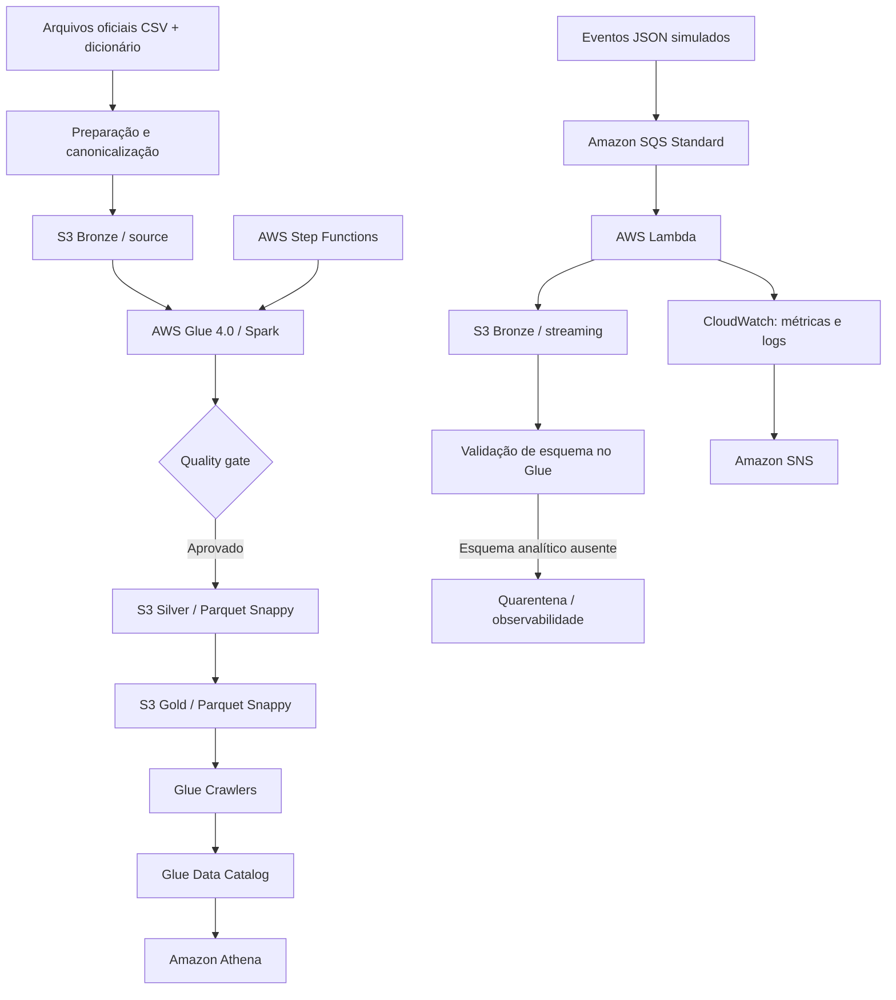

# Arquitetura e decisões técnicas

## 1. Objetivo

Implementar um pipeline de dados para integrar as fontes do Indicador Criança Alfabetizada, aplicar controles de qualidade e disponibilizar tabelas analíticas em arquitetura medalhão (Bronze, Silver e Gold). A implantação documentada utiliza AWS na região `us-east-2`.

A solução tem dois fluxos distintos:

1. **Batch analítico:** seis fontes de dados oficiais mais o dicionário oficial, processadas pelo AWS Glue.
2. **Entrada de eventos simulados:** mensagens SQS consumidas por Lambda e persistidas na Bronze do S3. Os eventos não são tratados como indicadores oficiais.

## 2. Visão lógica

**Importante:** no estado atual validado na AWS, os eventos de teste não continham todas as colunas necessárias ao modelo analítico de streaming. Por isso, foram preservados na Bronze e encaminhados para quarentena pelo processamento Glue. A tabela `mart_streaming_eventos` **não foi produzida nessa execução AWS**. O fluxo local possui evidência separada de processamento de eventos simulados.

## 3. Fluxo batch

1. Obter os seis CSVs oficiais e `dicionario.csv`.
2. Preservar os arquivos originais em `data/exports_raw/` e executar `python scripts/prepare_real_data.py`.
3. A preparação gera as sete fontes canônicas em `data/source/`, normaliza os nomes, converte as metas do formato largo para formato longo, preserva o ano do snapshot e deriva `sigla_uf` do prefixo do código IBGE quando a fonte não fornece a UF.
4. Enviar os arquivos canônicos para `s3://<bucket>/bronze/source/`.
5. O Glue lê as seis entidades analíticas e a tabela auxiliar `dicionario`, valida as fontes e os joins, e publica Silver/Gold com `run_id`.
6. Os crawlers catalogam Silver e Gold. Na implantação validada, eles foram iniciados após a execução da Step Functions.
7. Athena consulta as tabelas catalogadas. Para Gold, filtrar `run_id` para não misturar várias execuções.

### Camadas

| Camada | Função | Formato/observação |
|---|---|---|
| Bronze | Preservar entradas originais/canônicas, eventos e linhagem | CSV/JSONL, histórico e prefixos por execução |
| Silver | Dados limpos, normalizados, descrições derivadas do dicionário e indicadores intermediários | Parquet Snappy no Glue |
| Gold | Fato municipal, mart por UF, evolução temporal e reconciliação de microdados | Parquet Snappy, particionado por `run_id` |
| Quarentena/observabilidade | Registrar registros ou lotes que não atendem ao esquema/regras | JSON/Parquet conforme o estágio |

## 4. Fluxo de eventos

- Produtor: `scripts/send_sqs_events.py` envia mensagens JSON de demonstração.
- Fila: Amazon SQS Standard, com criptografia gerenciada pelo SQS, retenção de 24 horas e long polling.
- Consumidor: Lambda Python 3.12, acionada por event source mapping da fila.
- Persistência: JSONL em `bronze/streaming/`, com campos de ingestão e identificação da mensagem.
- Observabilidade: namespace CloudWatch `AlfabetizacaoPipeline`, métricas `EventsIngested`, `InvalidEvents` e `EventLatencySeconds`.
- O evento de demonstração observado continha campos operacionais (`event_timestamp`, `event_id`, UF, município e quantidade), mas não o conjunto de colunas analíticas exigidas para o fato. A ausência de colunas não deve ser preenchida por suposição: o lote é colocado em quarentena e não alimenta indicador oficial.

## 5. Componentes AWS implantados

| Componente | Configuração/uso |
|---|---|
| Amazon S3 | Data lake com versionamento, criptografia SSE-S3 e bloqueio de acesso público |
| Amazon SQS Standard | Entrada de eventos simulados |
| AWS Lambda | Consumidor SQS, gravação JSONL no S3 e métricas |
| AWS Glue 4.0 | Job Spark, dois workers G.1X, timeout de 30 minutos |
| Glue Crawlers | Catalogação das camadas Silver e Gold |
| Glue Data Catalog | Database e tabelas analíticas |
| AWS Step Functions | Orquestração da execução síncrona do Glue Job; não inicia os crawlers |
| Amazon Athena | Consultas SQL sobre Gold |
| Amazon CloudWatch | Logs, métricas e alarme de erros da Lambda |
| Amazon SNS | Destino das notificações de alerta |

Os nomes completos dos recursos são gerados pelo Terraform com sufixo aleatório. Não os codifique em scripts; use os outputs do Terraform ou consulte os recursos na região `us-east-2`.

## 6. Decisões e garantias

- **AWS em uma região:** `us-east-2`, evitando dependência desnecessária de múltiplas clouds.
- **SQS em vez de Kinesis:** a implantação final usa SQS Standard; Kinesis não está na infraestrutura ativa deste projeto.
- **Versionamento S3:** preserva versões anteriores; o ciclo de vida expira versões não correntes após 90 dias. Confirme se esse prazo atende à retenção acadêmica antes de manter a infraestrutura por períodos maiores.
- **Idempotência:** as saídas são identificadas por `run_id`; não misture execuções. O job limita execuções concorrentes.
- **Qualidade:** uma falha bloqueante impede a publicação das camadas seguintes. `PASSED` significa que as regras implementadas passaram, não que todas as fontes estejam completas.
- **Eventos:** SQS/Lambda deve ser tratado como entrega pelo menos uma vez; deduplicação por `event_id` é necessária para um fluxo analítico futuro.

## 7. Granularidades esperadas

| Entidade/tabela | Granularidade de referência |
|---|---|
| `uf` | ano + sigla_uf + série + rede |
| `municipio` | ano + id_municipio + série + rede |
| `meta_alfabetizacao_brasil` | ano-alvo + série + rede |
| `meta_alfabetizacao_uf` | ano-alvo + sigla_uf + série + rede |
| `meta_alfabetizacao_municipio` | ano-alvo + id_municipio + série + rede |
| `alunos` | id_aluno + ano + id_municipio + série + rede, sujeito à validação da fonte |
| eventos de streaming | event_id; eventos de teste não compõem o indicador oficial |

As chaves devem preservar as dimensões da fonte (ano, série e rede). Não remova dimensões apenas para aumentar a taxa de junção.

## 8. Interpretação dos produtos Gold

- `fato_alfabetizacao_municipio`: taxa municipal publicada e comparação com meta quando existe uma meta aplicável.
- `mart_alfabetizacao_uf`: agregação/visão por UF segundo a lógica do projeto; não deve ser apresentada como novo indicador oficial sem verificar o método da fonte.
- `mart_evolucao_temporal`: média simples entre municípios, não equivalente ao indicador nacional ponderado pelo número de alunos.
- `reconciliacao_microdados`: confronto exploratório entre a taxa calculada com microdados e a taxa agregada publicada. A suspeita de truncamento dos microdados impede tratá-lo como reconciliação estatística conclusiva.

## 9. Limitações de cobertura conhecidas

- A tabela de metas preparada cobre anos-alvo de 2024 a 2030; não há meta municipal de 2023 nessa extração.
- Para 2024, na rede municipal/série 2, 96 municípios não tinham linha correspondente na fonte de metas e 120 tinham a linha, mas o valor da meta estava vazio também no CSV bruto. Não substituir essas ausências por zero.
- Nos resultados AWS, `SEM_META` e `NAO_COMPARAVEL` são estados distintos e devem permanecer separados.
- `alunos.csv` contém 1.048.575 registros, quantidade imediatamente inferior ao limite de 1.048.576 linhas de uma planilha Excel com cabeçalho. É indício de possível truncamento, não prova. Confirmar a completude na origem antes de conclusões sobre microdados.

## 10. Fontes de implementação

- Preparação canônica: `scripts/prepare_real_data.py`.
- Job AWS: `jobs/glue_medallion_job.py`.
- Consumidor de eventos: `cloud/lambda/stream_to_s3.py`.
- Infraestrutura: `cloud/terraform/`.
- Dicionário e granularidade: `dicionario_dados.md`.
